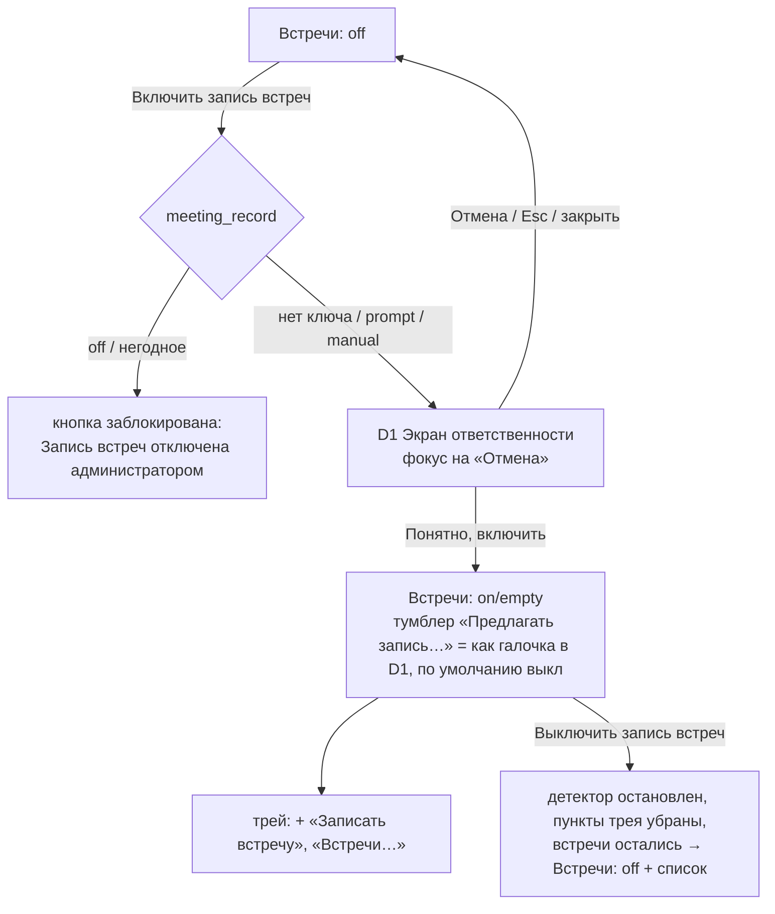

# Запись встреч (E13, F18) — флоу, состояния, макеты · UX-target к G3

Статус: **G2b пройден (12.10.2026) — развитые макеты к G3**; точные размеры снимает дизайн-спец. Автор: `ux-analyst`, 2026-10-12.
Учтена модель угроз `docs/security/T1-meetings-2026-10-12.md` (BL-3, BL-4, BL-5, MJ-2, MJ-11, MJ-13, MJ-15, MN-7, MN-15, MN-17).
Ownership: этот файл и `design/meetings/mockups/*`. `src/`, `qml/`, git не тронуты.

Вход: `stories.md` E13 (US-13.1…13.14, кроме 13.3 — Could, после v1.1), `PRD.md` F18 п. 1–14
и «Исключения», S23–S26, §9.5; `research/legal-meetings.md` M1–M12; `design/spec.md`
(§1 окно, §3 строки, §4 контролы, §8 пилюля, §9 трей, §11 диалоги, §12 темы),
`qml/Theme.qml` + `PillTheme.qml` (токены 2.3.1), `design/program-updates/spec.md` (формат),
`docs/plans.md` R4, `backlog.md` ревизия 14.

Макеты (самодостаточный HTML, без внешних зависимостей; переключатель темы вверху страницы,
`#dark` в адресе открывает тёмную; стенд-подписи вне окон в продукт не входят):

| Файл | Что | Истории |
|---|---|---|
| `mockups/index.html` | оглавление | — |
| `mockups/01-section.html` | раздел «Встречи»: выключено, политика, пустой список, список со всеми состояниями, настройки, замки | 13.1, 13.6, 13.10, 13.11, 13.12 |
| `mockups/02-responsibility.html` | экран ответственности: личный и корпоративный тексты, `manual` | 13.1, 13.2, 13.12 |
| `mockups/03-offer.html` | плашка «Записать?» (детектор): DION, браузер, на рабочем столе | 13.2 |
| `mockups/04-recording.html` | карточка старта и отказы, плашка записи (все состояния), карточка «Предупредите участников», трей, уведомления, выход | 13.4, 13.5, 13.6 |
| `mockups/05-meeting-A.html` | **карточка встречи — направление A «Документ»** (выбрано): 1024 и 900, расшифровка по ходу, имена, «Это один человек», меню, «Прослушать», сохранено | 13.7, 13.8, 13.11 |
| `mockups/06-meeting-states.html` | остальные состояния карточки: ошибки, нет модели, память, прервана, комната, без разделения, удалить, переименовать | 13.7, 13.11 |
| `mockups/07-templates.html` | D4 «Сохранить как…» — наш шаг перед системным диалогом; локальные шаблоны; ИИ — 13 состояний, предупреждение о внешнем адресе | 13.9, 13.10, 13.12 |

`05-meeting-B.html`, `05-meeting-C.html` — **сняты 12.10.2026** (решение владельца на G2b), оставлены как история, к реализации не относятся.

Окно настроек — канон `design/spec.md` §1: 1024×620 (минимум 900×588), сайдбар 184,
контент с отступами 22, StatusBar 36. Все цвета — токены `Theme.qml`; то, что рисуется поверх
чужого рабочего стола (плашки, карточка уведомления), — `PillTheme` (`color.fixed.*`),
с темой не меняется (§8.2, §11.2). Новых цветов нет. Новые глифы — §9.

---

## 0. Решения

| # | Решение | Статус |
|---|---|---|
| G2b | Карточка встречи — **A «Документ»**: внутри окна настроек, расшифровка таблицей «время · кто · текст», панель «Участники». Из B взят **номер спикера у каждой реплики** (нейтральный кружок `①`, без новой палитры). B «Беседа» и C «Окно встречи» сняты. | решение владельца 12.10 |
| В2 | Плашка записи и окно «Записать?» — **сверху по центру** рабочей области. | решение владельца 12.10 |
| В3 | Адрес сервиса ИИ задан администратором → под замком **только адрес**; «Модель» и «Ключ доступа» пользователь меняет сам, подсказка «Адрес задан администратором, модель и ключ — ваши». | решение владельца 12.10 |
| В4 | Расшифровка показывается **по ходу**: готовые реплики появляются сразу, строка статуса «Расшифровано 0:29:04 из 1:12:40 · имена спикеров уточняются до конца»; имена и «Это один человек» — только после окончания (T1 BL-3); выход из программы во время расшифровки — **без подтверждения**. | решение владельца 12.10 |
| В5 | Замков «Задано администратором» на строках «Встреч» **в v1.1 нет** — механизм в v1.2. Политика в v1.1 действует: строка серая и недоступна; причину объясняет **одна строка вверху раздела** «Часть настроек задана администратором вашей организации — они показаны серым и недоступны для изменения» (только если задан хоть один ключ `meeting_*`). | решение владельца 12.10 |
| T1 | Блокировка экрана → **пауза**, продолжение только нажатием (BL-5) — вместо «запись продолжается» из PRD F18.4 (з). Потеря обоих индикаторов → пауза (BL-4). | требование ИБ, подтверждено владельцем 12.10 (Q1); PRD правит PM |

Узкое окно (контент < 760 px, окно уже ≈ 990): панель «Участники» складывается в **полосу над таблицей** + кнопка
«Имена участников», которая открывает **выезжающую панель 300 px** справа поверх таблицы (§5.2).

## 1. Карта экранов и объектов

```
Astra Voice
├─ Окно настроек
│   └─ Встречи (новый раздел, 7-й; место — после «Вывод», перед «Сеть и обновления»)
│       ├─ off            — функция выключена: одна карточка «Включить запись встреч»
│       ├─ policy-off     — `meeting_record=off` (или негодное): кнопка недоступна, встречи только открыть/сохранить/удалить
│       ├─ on/empty       — включено, встреч нет
│       ├─ on/list        — список встреч + настройки (Запись · Предупреждение участников ·
│       │                   Расшифровка · Хранение · Шаблоны с ИИ · Выключить)
│       └─ meeting        — карточка встречи (A «Документ»; ≥ 760 px контента — панель «Участники»
│                           справа, уже — полоса над таблицей + выезжающая панель)
├─ Диалоги окна настроек (модальны к окну, §11.1)
│   ├─ D1 Экран ответственности (ширина 520 — исключение из 420, текст длинный)
│   ├─ D2 Удалить встречу
│   ├─ D3 Переименовать встречу
│   ├─ D4 «Сохранить как…» — наш шаг перед системным диалогом: шаблон, формат, предпросмотр, ИИ (760)
│   ├─ D5 Предупреждение перед отправкой на внешний адрес ИИ
│   └─ D6 системный диалог файлов (KDE-портал / Qt во Fly) — открывается из D4
├─ Окна поверх рабочего стола (свои окна, не забирают фокус, `color.fixed`)
│   ├─ W1 Предложение «Записать?» (детектор)
│   ├─ W2 Плашка записи (полная / свёрнутая)
│   └─ W3 Карточка «Предупредите участников о записи»
├─ W4 Карточка старта «Записать встречу» — обычное маленькое окно (берёт фокус: его открыл человек)
├─ Трей — 2 новых состояния значка, пункты меню
└─ Уведомления — штатные `org.freedesktop.Notifications` (KDE и Fly); при недоступной службе
    во Fly — запасной текст в плашке W2 (S17-A4)
```

---

## 2. Флоу

### 2.1 Включение функции (US-13.1, M4)



- Экран ответственности показывается **при каждом** включении (после выключения — снова). Повторное
  включение без него невозможно ни при каком значении политики (US-13.12).
- Галочка «Предлагать запись, когда начинается звонок» на D1 — по умолчанию **не отмечена**
  (F18.2 (а)); при `manual` — заблокирована неотмеченной с замком; если ни одна программа ещё не
  узнаётся (до SP3) — галочки нет вовсе.
- «Выключить запись встреч» во время записи недоступна: «Сначала остановите запись встречи».

### 2.2 Звонок → предложение → запись (US-13.2, S23)

```
⚙ программа из списка держит микрофон + вывод ≥ 5 с
   └─ проверки: функция on · тумблер on · не manual/off · сеанс активен · экран не заблокирован (и это известно — BL-5) ·
               записи нет · в этом звонке ещё не отказывались
        ├─ нет → ничего (после разблокировки при идущем звонке — повторить проверку)
        └─ да  → W1 «Идёт звонок в DION. Начать запись встречи?» (≤ 2 с, без фокуса, 60 с)
                 ├─ 🖱 «Начать запись» → запись, вариант 1 «Звонок в DION», с этого момента
                 │                      → W2 плашка + W3 «Предупредите участников» (§2.3)
                 ├─ 🖱 «Не записывать» / «×» / 60 с / ⚙ звонок кончился (микрофон свободен ≥ 10 с)
                 │      → W1 закрыт, до конца ЭТОГО звонка — тишина; трей «Записать встречу» доступен
                 └─ ⚙ экран заблокирован, пока W1 открыт → W1 закрыт без ответа (как «Не записывать»
                        не считается: после разблокировки, если звонок идёт, — предложить снова)
```

Пока W1 открыт, звук не открыт вовсе (S23-A2) — в макете это сказано текстом самой плашки
(«Сказанное до нажатия в запись не попадёт»), чтобы человек не думал, что «уже пишется».

### 2.3 Ручной старт (US-13.4, S24-A1/A12)

```
🖱 трей «Записать встречу» | Встречи → «Записать встречу»
   └─ W4 Карточка старта (обычное окно, фокус на «Начать запись»)
        выбор: (1) «Звонок в DION» — если идёт звонок в программе из списка, выбран
               (1′) «Звонок в браузере» — звук браузера целиком, строка об этом
               (2) «Встреча в комнате — только микрофон» — иначе выбран
               (3) «Весь звук компьютера и микрофон» — строка «попадут все звуки»
        подсказки: вывод в колонки → «В гарнитуре запись будет чище…»
                   SP1: нельзя отделить звук программы → строка «попадёт весь звук компьютера» у (1)
        └─ 🖱 «Начать запись»
             ├─ проверки до открытия звука: место ≥ 600 МБ · каталог доступен · звуковая служба отвечает ·
             │   состояние блокировки экрана известно (BL-5 п. 3) · записи нет → иначе W4 остаётся, ошибка в карточке
             │   (§4.4), ничего не создано
             ├─ ПРЕДУПРЕЖДЕНИЕ, не отказ (решение владельца 12.10): каталог на сетевом диске / звуковая служба не на
             │   этом компьютере (MJ-15) → жёлтая карточка в W4, «Начать запись» доступна, у встречи — отметка
             └─ ок (≤ 1 с) → W4 закрыт · W2 плашка «● Запись встречи 0:00:01» · W3 карточка
                             «Предупредите участников» · трей rec · пункт «Встречи» в списке: «Идёт запись»
```

### 2.4 Во время записи (US-13.4, 13.5, 13.6; S24)

```
W2 recording ──🖱 Пауза──▶ W2 paused (звук закрыт, таймер стоит, «на паузе 0:03»)
   ▲                        ├─🖱 Продолжить → recording (отметка паузы в расшифровке)
   │                        └─⚙ 60 мин паузы → встреча завершена и сохранена → §2.5
   ├─⚙ 1:55:00 → W2 limit «Остановится через 5:00» + «Продлить на час» (+ уведомление)
   │      ├─🖱 Продлить → лимит +1 ч (не больше 4:00:00; на 3:55 последнего продления кнопки нет)
   │      └─⚙ 2:00:00 → stop, «Запись встречи остановлена: достигнут предел длительности»
   ├─⚙ микрофон сменился/пропал → W2 mic-paused + уведомление
   │      [Продолжить с „Встроенный микрофон“] [Остановить запись]; собеседники пишутся дальше
   ├─⚙ программа видеосвязи закрылась → дорожка собеседников стоп, отметка; W2 строка-причина
   ├─⚙ свободно < 200 МБ → stop, «Запись остановлена: заканчивается место на диске»
   ├─⚙ экран заблокирован или это нельзя узнать → ≤ 1 с ПАУЗА (T1 BL-5); после разблокировки W2 paused-lock
   │      «Пауза · экран был заблокирован» + уведомление [Продолжить]; продолжение — только нажатием; 60 мин → сохранить
   ├─⚙ пропали И значок трея, И плашка > 1 с / программа не отвечает > 5 с → ПАУЗА (T1 BL-4);
   │      индикация вернулась → продолжение само, отметка в расшифровке, строка на W2 8 с
   ├─⚙ сон / смена сеанса → stop до сна, уведомление после пробуждения
   ├─🖱 «Свернуть» → W2 compact (знак + таймер); скрыть нельзя; настройка пилюли «Индикатор» на W2 и трей не действует (BL-4)
   ├─🖱 «Текст для участников» (на W2 или в трее) → W3 снова открыта
   ├─🖱 Выход из программы → диалог «Идёт запись встречи. Остановить запись и выйти?»
   └─🖱 Остановить (W2 или трей) → ≤ 1 с захват закрыт → §2.5
```

### 2.5 После остановки (US-13.7, 13.11)

```
stop → уведомление «Встреча сохранена. Делаю расшифровку…» (если «Расшифровывать сразу» вкл.)
     → в списке «Расшифровывается · 12 %», трей-подсказка «Расшифровка встречи: 12 %»
        ├─ нет GigaAM v3 → «Нужна модель» + «Установить» (F7, в т.ч. из файла)
        ├─ мало памяти → «Ждёт памяти» («Расшифровка подождёт: сейчас мало свободной памяти»)
        ├─ самопроверка модели не прошла → «Ошибка расшифровки»: «Распознавание на этом компьютере не работает»
        ├─ 🖱 «Отменить» → «Записана» (звук цел), «Расшифровать» доступна
        ├─ ⚙ перезапуск программы → продолжается сама
        └─ готово → «Готово» · звук удалён (если хранение = «Не хранить») · уведомление
                    «Расшифровка готова: <название>» [Открыть]
«Расшифровывать сразу» выкл. → состояние «Записана» + кнопка «Расшифровать»
kill -9 → при запуске: уведомление и строка списка «Прервана · сохранено 0:37:02» [Расшифровать] [Удалить]
```

### 2.6 Карточка встречи → имена → шаблоны → экспорт / удаление (US-13.8–13.11)

```
Встречи → «Открыть» → карточка встречи (внутри окна настроек, «← Все встречи»)
   ├─ идёт расшифровка → реплики появляются по ходу, «Спикер N» без имён; имена и объединение недоступны (BL-3, В4)
   ├─ Имена участников: «Спикер 2 · 12 мин · „…первые реплики…“» [поле «Имя»]
   │     ввод → подстановка во всех репликах ЭТОЙ встречи и в шапке (сразу, без «Сохранить»)
   │     «Это один человек» → поповер «Спикер 3 — это…» [выбор] «Разделить обратно будет нельзя» → Объединить →
   │          реплики объединены, спикер исчез из панели, статистика пересчитана, тост 4 с
   │     (подсказок из прошлых встреч нет; «найти ещё реплики» нет — П15)
   ├─ «Сохранить как…» → D4: Стенограмма (по умолч.) · Я и собеседники · Только текст · Статистика встречи
   │     [+ Краткое содержание · Протокол: решения и поручения — только если задан адрес ИИ]
   │     локальный → предпросмотр + формат (.md/.txt) → «Выбрать папку и сохранить…» → D6 системный диалог →
   │          тост «Сохранено в «Документы»: <имя>» [Открыть папку]; файл 0600 (MN-15)
   │     ИИ → «Сделать» → (внешний адрес и нет allow_external) D5 — перед КАЖДОЙ отправкой, и «Повторить» тоже →
   │          адрес перепроверен (изменился → отмена) → отправка; с начала передачи — отметка «мог быть получен»
   │          (MJ-13) → ответ санитизирован, метка «Сделано сервисом ИИ…» (MJ-11), сохранён в данных встречи; ошибки §4.7
   ├─ «⋯» / значок карандаша → Переименовать → D3 (имя встречи; 1–120 символов)
   ├─ «Прослушать» — кнопка в шапке ТОЛЬКО в audio-kept (звук хранится 7/30 дней); плеер-строка (Could)
   └─ «⋯» → Удалить → D2 подтверждение → каталог удалён (MJ-14: задания остановлены) → назад к списку
```

### 2.7 Политика администратора (US-13.12) — сводка по экранам

| Ключ | Где видно | Годное значение | Негодное |
|---|---|---|---|
| `meeting_record=off` | «Встречи» (вся функция), трей | карточка off с замком «Запись встреч отключена администратором»; список встреч остаётся: Открыть / Сохранить как… / Удалить; «Расшифровать» нет | то же + «значение политики некорректно — обратитесь к администратору» |
| `meeting_record=manual` | тумблер «Предлагать запись…», галочка в D1 | недоступны, выключены | — (негодное = off) |
| `meeting_record=prompt` | — | как без ключа (замков нет) | — |
| `meeting_diarization` | «Разделять собеседников по голосам» | серая на значении | серая на «выкл» + текст об ошибке |
| `meeting_ai_endpoint` | строки «Адрес», «Модель»*, «Ключ доступа»* | URL — адрес серый, недоступен; `off` — группа «Шаблоны с ИИ» = одна строка «Шаблоны с ИИ отключены администратором» | как `off` + текст об ошибке |
| `meeting_ai_allow_external` | под адресом | `true` — строка «Внешний адрес согласован администратором — предупреждения перед отправкой не будет» | как `false` |
| `meeting_ai_allow_plaintext` (7-й, имя — предложение ИБ, утвердить PM/архитектору) | строка адреса | `true` **только вместе с адресом из политики** — `http://` на этот адрес разрешён; под адресом «Без шифрования, разрешено администратором» | как нет ключа: `http://` не на loopback → ошибка |
| `meeting_audio_retention_days` | «Хранить запись звука после расшифровки» | серая на «N дней» (значение вне списка 0/7/30 — показываем как есть: «14 дней») | серая на «Не хранить» |
| `meeting_notice_text` | «Текст для чата встречи», W3 | поле серое, только для чтения; W3 показывает текст администратора | текст по умолчанию, поле серое |

\* «Модель» и «Ключ доступа» при адресе из политики остаются редактируемыми (В3 — решение владельца 12.10).

**v1.1 (В5):** замков на строках нет. Значение из политики показывается в контроле, контрол недоступен и окрашен
`fgDisabled` (без прозрачности); над группами раздела — одна `note`-строка с глифом замка: «Часть настроек задана
администратором вашей организации — они показаны серым и недоступны для изменения». Исключения, где причина —
содержание, а не замок строки: карточка-вход при `meeting_record=off` («Запись встреч отключена администратором»,
US-13.1), группа «Шаблоны с ИИ» при `meeting_ai_endpoint=off` («Шаблоны с ИИ отключены администратором»), строка
«Адрес задан администратором, модель и ключ — ваши» (В3), подпись галочки в D1 при `manual` («Недоступно — так
настроено администратором вашей организации»). Негодное значение — тот же серый вид; в карточке-входе — строка
«Значение политики некорректно — обратитесь к администратору», для остальных ключей — журнал и документ администратора.
**v1.2:** бейдж `lockBadge` «Задано администратором» у каждой строки (канон `design/spec.md` §3.2/§4.8), общая строка
не нужна — макет «5б» в `01-section.html` помечен как будущее.

---

## 3. Состояния по компонентам

Каждый компонент — пять базовых (`loading · empty · error · disabled · success`) + политика (v1.1 — серый контрол и общая строка; замок строки — v1.2) +
среда (KDE/Fly). «—» = состояния нет по смыслу (сказано почему).

### 3.1 Раздел «Встречи» (`01-section.html`)

| Состояние | Что видно |
|---|---|
| `off` (чистая установка) | шапка раздела; одна карточка-«вход»: заголовок «Запись встреч выключена», 2 строки описания, primary «Включить запись встреч», строка «Пока функция выключена, программа не следит за звонками и ничего не записывает.» Больше в разделе ничего нет (US-13.1). |
| `off` + сохранённые встречи | карточка-вход + группа «Записанные встречи» (после выключения встречи остаются) |
| `policy-off` | карточка-вход: кнопка disabled, рядом текст с глифом замка «Запись встреч отключена администратором» (не бейдж — v1.1); если ключ негодный — второй строкой `dangerInk` «Значение политики некорректно — обратитесь к администратору» |
| `policy-some` (v1.1) | `note` вверху раздела «Часть настроек задана администратором…»; строки по ключам — серые, без бейджей. **Замки на строках — v1.2** |
| `loading` | список читается с диска при открытии раздела: ≤ 300 мс — ничего; дольше — 3 строки-заглушки `bgSurface2` высотой 44 без анимации (мигание запрещено, §Сквозные 4) |
| `empty` (включено, встреч нет) | в карточке списка одна строка: «Встреч пока нет. Нажмите „Записать встречу“ или выберите этот пункт в меню значка в трее.» |
| `success` (список) | строки встреч, итог «Всего: 5 встреч · 412 МБ» |
| `error` чтения каталога | строка в карточке списка, `dangerInk` + иконка: «Не удалось прочитать папку встреч. Проверьте, что диск подключён и доступен.» [Повторить] |
| `recording` | кнопка шапки «Записать встречу» disabled + подпись под ней «Уже идёт запись встречи»; строка идущей встречи первая, с таймером; «Выключить запись встреч» disabled |

**Строка встречи** — состояние → бейдж (`badge`, форма + текст, не только цвет) и действия:

| Состояние | Бейдж | Под названием | Главная кнопка | Меню «⋯» |
|---|---|---|---|---|
| Идёт запись | `primaryBg` «● Запись · 0:42:10» | дата · начало | «Остановить» | — |
| На паузе | `bgSurface2` «‖ Пауза · 0:42:10» | то же | «Продолжить» | Остановить |
| На паузе: экран был заблокирован (BL-5) | `bgSurface2` «‖ Пауза · 0:42:10» | «Экран был заблокирован — продолжите вручную» | «Продолжить» | Остановить |
| Записана (не расшифрована) | `bgSurface2` «Записана» | дата · длит. · место | «Расшифровать» | Переименовать, Удалить |
| Расшифровывается | `warningBg` «Расшифровка · 40 %» + полоска 4 px под строкой | дата · длит. · место | «Отменить» | Переименовать, Удалить |
| Ждёт памяти | `warningBg` «Ждёт памяти» | «Расшифровка подождёт: сейчас мало свободной памяти» | — | Отменить, Удалить |
| Нужна модель | `warningBg` «Нужна модель» | «Для расшифровки встреч нужна модель GigaAM v3» | «Установить» | Удалить |
| Готово | `successBg` «✓ Готово» | дата · длит. · место · «звук удалён» / «звук до 19.10» | «Открыть» | Сохранить как…, Имена участников, Переименовать, Удалить |
| Ошибка расшифровки | `dangerBg` «! Ошибка расшифровки» | простая причина | «Повторить» | Удалить |
| Прервана | `warningBg` «Прервана» | «Сохранено 0:37:02 — программа закрылась во время записи» | «Расшифровать» | Удалить |
| политика `off` | бейдж как был | — | «Открыть» (только для «Готово») | Сохранить как…, Удалить |

Длительность и размер — PT Mono (сравниваются по вертикали, §Сквозные 5). Название — elide
справа, полное — подсказкой и в карточке встречи.

### 3.2 Экран ответственности D1 (`02-responsibility.html`)

| Состояние | Что видно |
|---|---|
| по умолчанию | текст §4.2, галочка детектора не отмечена, фокус на «Отмена» |
| корпоративный | в `policy.conf` есть хоть один ключ `meeting_*` → последний абзац — текст для организации (§4.2) |
| `manual` | галочка детектора недоступна, не отмечена; подпись «Недоступно — так настроено администратором вашей организации» (v1.1, без бейджа; замок — v1.2) |
| нет узнаваемых программ | галочки нет |
| `loading/empty/error` | — (статичный текст) |
| `disabled` | «Понятно, включить» не бывает disabled — человек может согласиться сразу; прокрутка до конца не требуется. Высота D1 по содержимому — 685 (PT Root UI) > клиентской области (588 / 556): **max-height = клиентская высота − 48** (540 при 1024×620, 508 при 900×588), шапка и кнопки закреплены, тело прокручивается, над кнопками разделитель `borderSoft` |

### 3.3 Предложение W1 (`03-offer.html`)

| Состояние | Что видно |
|---|---|
| `call-app` | «Идёт звонок в DION. Начать запись встречи?» |
| `call-browser` | «Идёт звонок в браузере. Начать запись встречи?» + «Запишется звук браузера целиком — всех вкладок.» |
| отсчёт | полоска 2 px внизу убывает за 60 с (`linear`, не мигание) + «Закроется через 42 с» |
| hover на кнопках | как notify-кнопки §11.2 |
| `starting` | после «Начать запись» кнопка → спиннер «Начинаю…» ≤ 1 с, затем W1 превращается в W2 на том же месте |
| `start-failed` | текст ошибки старта (§4.4) + «Открыть встречи», W1 остаётся до закрытия × |
| `disabled/empty/loading` | — (окна нет) |

### 3.4 Карточка старта W4 (`04-recording.html`)

`default` (комната) · `call` (DION выбран) · `browser` · `no-app-split` (SP1: строка у (1)) ·
`speakers` (подсказка про гарнитуру) · `starting` (кнопка со спиннером, радиокнопки disabled) ·
`error-disk` · `error-audio` · `error-folder` · **`error-lock-unknown`** (Fly без сведений о блокировке, BL-5 п. 3 —
«Начать запись» недоступна, ничего не создано) · **`warn-nfs`** и **`warn-remote-audio`** (MJ-15; решение владельца
12.10 — жёлтое предупреждение, «Начать запись» доступна; у встречи остаётся отметка) · `error-busy` («Уже идёт запись встречи» — вместо карточки
открывается плашка W2 и всплывает подсказка) · политика `off` — пункта нет нигде, карточка не открывается.

### 3.5 Плашка записи W2

| Состояние | Знак | Текст | Кнопки |
|---|---|---|---|
| `recording` | кольцо с точкой `pillBarLive` | **Запись встречи** `0:42:10` | ‖ Пауза · ■ Остановить · 💬 · collapse ›‹ |
| `paused` | две черты `pillIconMuted` | **Пауза** `0:42:10` (таймер `pillIconNeutral`); подсказка при наведении «На паузе 3 мин. Через 60 мин паузы встреча сохранится» | ▶ Продолжить · ■ Остановить · 💬 · collapse ›‹ |
| `limit-soon` | `clock` `pillWarning` | ряд 1 как `recording`; **ряд 2**: «Остановится через 4:48» `pillWarning` + «Продлить на час» (primary) | Пауза · Остановить · 💬 · ›‹ |
| `mic-paused` | `alert` `pillWarning` | ряд 1 как `recording`; **ряд 2**: «Ваш голос не записывается: микрофон сменился» + «Продолжить с „<устройство>“»; длинное имя (> 24 симв.) — кнопка «Продолжить с другим микрофоном», имя — в тексте ряда 2 | Пауза · Остановить · 💬 · ›‹ |
| `app-closed` | кольцо | ряд 1 как `recording`; **ряд 2** (8 с): «DION закрылся — пишется только микрофон» | как `recording` |
| `compact` | знак состояния | `0:42:10` | expand ‹› (подсказка «Развернуть плашку»); перетаскивается за ручку |
| `stopping` | спиннер | «Сохраняю запись…» (≤ 1 с) | — |
| `paused-lock` (BL-5) | две черты | ряд 1 как `paused`; **ряд 2**: «Экран был заблокирован — продолжите вручную» `pillWarning` | ▶ Продолжить (только нажатием) · ■ Остановить · 💬 · ›‹ |
| `paused-indicator` (BL-4) | — (плашки не видно) → после возврата: кольцо | «Запись стояла на паузе 0:00:14: индикатор записи не отображался. Отметка — в расшифровке» (8 с) | как `recording` |
| `paused-hang` (BL-4 п. 5) | то же | «…: программа не отвечала…» (8 с) | как `recording` |
| `notify-fallback` (Fly без службы уведомлений) | как текущее | текст уведомления второй строкой плашки | кнопка действия уведомления |
| `error` (звуковая служба упала во время записи) | `alert` `pillError` | «Запись остановлена: звуковая служба не отвечает. Записанное сохранено» (3 с), затем плашка уходит | — |

Скрыть плашку нельзя ни в одном состоянии: нет «×», нет пункта меню; плашка и значок трея **не читают** настройку
пилюли «Индикатор» и не имеют своего выключателя (BL-4). Перекрытие плашки полноэкранным окном при живом трее —
не потеря индикации.

### 3.6 Карточка «Предупредите участников» W3

`default` · `copied` (кнопка «✓ Скопировано» 1,2 с, затем обратно; **никаких** «участники
предупреждены») · `admin-text` (текст администратора, строка «Текст задан администратором»
`notifyFgMuted`) · `closed` (открывается снова из 💬 на плашке и из трея). `loading/empty/error` —
нет: текст всегда есть (по умолчанию или администратора); если в буфер обмена записать не удалось —
кнопка «Не удалось скопировать — выделите текст и скопируйте вручную», текст выделяемый.
Нижняя строка всегда (MN-17): «Ваш микрофон записывается всё время записи — выключенный микрофон в DION на
запись не влияет. Чтобы не записывать, нажмите «Пауза».»

### 3.7 Карточка встречи (`05-meeting-A.html`, `06-meeting-states.html`)

| Состояние | Что видно | Где |
|---|---|---|
| `transcribing` (В4) | бейдж «Расшифровка · 40 %»; над таблицей карточка прогресса «Расшифровано 0:29:04 из 1:12:40 · имена спикеров уточняются до конца» + «Готовые реплики появляются сразу. Можно закрыть окно или выйти из программы — расшифровка продолжится.» + полоса + «Отменить»; реплики по мере готовности, последняя строка «Дальше — по мере расшифровки»; подписи «Спикер N» без имён; поля имён и «Это один человек» недоступны (BL-3); «Сохранить как…» и «⋯ → Имена» нет | 05 §3 |
| `ready` | таблица + панель (≥ 760) или полоса (< 760) | 05 §1–2 |
| `names-edit` | поле имени в фокусе; таблица и шапка меняются на каждый ввод; < 760 — выезжающая панель | 05 §2 |
| `merge` | поповер у спикера: «Спикер 3 — это…» · выбор · «Разделить обратно будет нельзя» · «Отмена» (фокус) / «Объединить» | 05 §4 |
| `merged` | спикер исчез из панели, реплики переподписаны, тост «Спикер 3 объединён с «Ирина Соколова» · статистика пересчитана» 4 с | 05 §4 |
| `menu` | «⋯»: Переименовать… · Имена участников · Удалить встречу… | 05 §5 |
| `audio-kept` | кнопка «Прослушать» в шапке **только здесь**; подстрока «звук хранится до 19.10»; плеер-строка (Could) | 05 §5 |
| `saved` | тост «Сохранено в «Документы»: Планёрка по бюджету.md» [Открыть папку], 4 с | 05 §5 |
| `cancelled` → «Записана» · `no-model` · `wait-memory` · `error` (самопроверка) · `interrupted` · `empty` (речи нет) · `room` · `no-diarization` · `policy-off` (только чтение, «Сохранить как…», удалить) | панель-сообщение вместо таблицы или над ней | 06 |
| `rename` D3 · `delete` D2 (два вида: без ИИ / была попытка отправки в ИИ) | диалоги | 06 |

Отметки встречи (бейджи под шапкой и строки в таблице): пауза; ваш микрофон не записывался; **«Пауза: экран был
заблокирован»** (BL-5 — вместо «экран был заблокирован, запись шла»); «Пауза: индикатор записи не отображался» (BL-4);
кусок записи повреждён; программа видеосвязи закрылась; MN-2 — «Записан весь звук компьютера», если SP1 не дал звук
отдельной программы; **«Хранится на сетевом диске»** и **«Звук шёл через другой компьютер»** (`warningBg`, если при
старте было предупреждение MJ-15) — и в шапке файла расшифровки.

### 3.8 «Сохранить как…» и шаблоны (`07-templates.html`)

D4 — наш шаг перед системным диалогом. Локальные: `preview` · `saving` · `saved` (тост, без полного пути) ·
`save-error` («Не удалось сохранить файл: папка недоступна для записи»).
ИИ: `hidden` (адреса нет / `off`) · `ready` (внутренний — галочка замены имён снята; внешний — строка «перед
отправкой программа предупредит») · `warn-external` D5 (**перед каждой** отправкой, включая «Повторить» и «Сделать
заново») · `sending` · `done` (санитизированный ответ + метка «Сделано сервисом ИИ по тексту встречи — проверьте по
стенограмме. Ссылки и картинки из ответа убраны», MJ-11) · `err-net` (до отправки — «не отправлен») ·
`err-auth` / `err-time` / `err-redirect` / **`maybe-sent`** (после начала передачи — «мог быть получен сервером <хост>»,
MJ-13) · **`addr-changed`** (адрес изменился между проверкой и отправкой — отмена, MJ-2 п. 4) · `too-long` · `empty` ·
`offline` · **`ready-plain`** (седьмой ключ: «Уйдёт на 10.0.5.20 — адрес внутри вашей сети, без шифрования, разрешено
администратором»). Кнопка «Выбрать папку и сохранить…» для шаблона ИИ доступна только в `done`.

### 3.9 Трей

| Состояние | Значок (22/16) | Подсказка |
|---|---|---|
| `meeting-rec` (новое) | третья точка → **кольцо с точкой** (22: кольцо r 2.5, обводка 1, центр 14.8/8.4849, точка r 1.15; 16: кольцо r 2.5 ⌀6, точка r 1, центр **12**/5 — по пиксельной сетке), цвет `indicatorListening` | Идёт запись встречи · 0:42:10 |
| `meeting-paused` (новое) | третья точка → **две вертикальные черты** `currentColor` (22: 1.6×4.63, зазор 1.2; 16: 2×4 px, зазор 1, по пиксельной сетке) | Запись встречи на паузе · 0:42:10 |
| диктовка во время записи | на время диктовки — штатные `listening/processing/done`, затем снова `meeting-rec` | штатная |
| расшифровка в фоне | `idle` (диктовка доступна) | «Astra Voice — готов · Ctrl+Space» + вторая строка «Расшифровка встречи: 40 %» |

Точки 1–2 и строка — без изменений, канон `design/spec.md` §9.1; **22 и 16 — самостоятельные рисунки**, 16 не масштаб 22.
Файлы-предложения: `design/meetings/icons/{22x22,16x16}/astravoice-tray-meeting-{rec,paused}.svg` (контракт Plasma
`currentColor`/`ColorScheme-Text` сохранён). Меню — §4.5. Во Fly с XEmbed: подсказка с таймером может не обновляться живьём — индикатором
служит плашка W2 (она обязательна и так); значок различим формой.

---

## 4. Тексты (точные; слово, запрещённое M11, не используется нигде — US-13.14)

Правила: простой язык (§Сквозные 7) — ни путей, ни имён файлов, ни «PipeWire», ни «эмбеддингов»;
ошибка = что случилось · что сделать · кнопка. Программа **нигде** не пишет, что участники
предупреждены или согласились (US-13.6, M3).

### 4.1 Раздел «Встречи»

- Сайдбар: **«Встречи»**; подзаголовок раздела: «Запись встреч и расшифровка на этом компьютере».
- Карточка-вход (off): заголовок «Запись встреч выключена»; текст «Astra Voice может записать
  встречу — ваш микрофон и звук собеседников из программы видеосвязи — и сделать из записи текст
  прямо на этом компьютере, без интернета. Запись начинается, только когда вы нажмёте
  „Начать запись“.»; кнопка «Включить запись встреч»; строка `fgMuted` «Пока функция выключена,
  программа не следит за звонками и ничего не записывает.»
- Политика: «Запись встреч отключена администратором». Негодное значение: «Значение политики некорректно —
  обратитесь к администратору». Общая строка (v1.1): «Часть настроек задана администратором вашей организации —
  они показаны серым и недоступны для изменения».
- Шапка (on): кнопка «Записать встречу» (primary, глиф записи); во время записи disabled + «Уже идёт
  запись встречи».
- Группа **«ЗАПИСАННЫЕ ВСТРЕЧИ»**; итог «Всего: 5 встреч · 412 МБ»; пусто — §3.1.
- Название по умолчанию: «Встреча 24.09.2026 14:00».
- Группа **«ЗАПИСЬ»**:
  - «Предлагать запись, когда начинается звонок» · подпись «Программа заметит звонок и спросит.
    Сама запись не начнётся» · `?`: «Программа видит только, какая программа открыла микрофон и звук,
    — не сам звук. Узнаёт: DION, звонок в браузере (Яндекс Телемост и другие сайты). SaluteJazz —
    в следующих версиях.»
  - строка «Какие звонки узнаются» · подпись «DION · звонок в браузере» (только чтение; список —
    данные программы).
- Группа **«ПРЕДУПРЕЖДЕНИЕ УЧАСТНИКОВ»**:
  - «Текст для чата встречи» · подпись «Показывается при каждом начале записи — с кнопкой
    „Скопировать для чата“» · поле, по умолчанию «Я веду запись и расшифровку этой встречи для
    протокола.» (1–500 символов, одна строка; пустое поле при выходе → текст по умолчанию).
  - «Текст для приглашения на встречу» · подпись «Предупредить заранее надёжнее всего — добавьте
    этот текст в приглашение» · поле «На встрече может вестись запись и расшифровка для протокола.
    Запись хранится только на компьютере участника, который её ведёт.» · кнопка «Скопировать» →
    «✓ Скопировано» 1,2 с.
- Группа **«РАСШИФРОВКА»**:
  - «Модель для расшифровки» · подпись «GigaAM v3 RNN-T · установлена» / «Не установлена — без неё
    расшифровки не будет» + «Установить».
  - «Расшифровывать сразу после записи» (вкл.).
  - «Разделять собеседников по голосам» (вкл.) · подпись «Собеседники станут „Спикер 1, 2…“.
    Голоса не запоминаются — ни между встречами, ни внутри встречи».
  - «Как подписывать вас в расшифровке» · поле «Я» (1–40 символов).
- Группа **«ХРАНЕНИЕ»**:
  - «Хранить запись звука после расшифровки» · «Не хранить» / «7 дней» / «30 дней» · подпись
    «Расшифровка остаётся. Если расшифровать не удалось, звук не удаляется».
  - «Удалять встречи старше» · «Никогда» / «30 дней» / «90 дней» / «365 дней».
  - строка-пояснение (без контрола) «Встречи хранятся только на этом компьютере и доступны только
    вашей учётной записи».
- Группа **«ШАБЛОНЫ С ИИ»**:
  - баннер `note`: «Краткое содержание и протокол встречи делает языковая модель на сервере, адрес
    которого вы укажете. Текст встречи уходит туда только по вашему нажатию. Пока адреса нет, этих
    шаблонов нет.»
  - «Адрес сервиса ИИ» · поле, плейсхолдер `https://…/v1` (моно) · под полем класс адреса:
    «Адрес внутри вашей сети» (`successInk`, значок дома) / «Внешний адрес — перед каждой отправкой
    программа предупредит» (`warningInk`, значок глобуса) / «Внешний адрес согласован
    администратором — предупреждения перед отправкой не будет» / «Внешний адрес недоступен
    в офлайн-режиме».
    Ошибка поля (MJ-2, когда разрешения администратора нет): «Адрес с http:// допустим только для этого компьютера
    (localhost). Для других адресов нужен https://» — рамка `dangerInk`, «Проверить» недоступна. Класс для loopback:
    «Сервис на этом компьютере». Администратор разрешил `http://` для своего адреса (седьмой ключ, §2.7) → адрес
    серый, под ним `warningInk`: «Без шифрования, разрешено администратором · адрес внутри вашей сети».
  - адрес задан администратором → строка адреса серая (v1.1; замок — v1.2) и строка `bgSurface2`: «Адрес задан администратором, модель
    и ключ — ваши» (В3).
  - «Модель» · поле (имя модели на сервере).
  - «Ключ доступа» · поле-пароль, «необязательно» · подпись «Хранится в системном хранилище паролей»
    (если хранилища нет: «Хранится в защищённом файле в папке настроек»).
  - кнопка «Проверить» → «Проверяю…» → «✓ Сервис ИИ отвечает» / «Сервис ИИ не ответил: <причина>»
    (причины §4.7). Подпись под кнопкой: «Отправит пробный запрос без текста встреч».
  - политика `off`: группа = одна строка «Шаблоны с ИИ отключены администратором».
- Низ раздела: secondary «Выключить запись встреч» · подпись «Сохранённые встречи останутся.
  Удалить их можно в списке выше»; во время записи disabled + «Сначала остановите запись встречи».

### 4.2 Экран ответственности D1

Шапка диалога: «Запись встреч». Заголовок тела (h3): «Перед тем как включить».

Пять пунктов (глиф 16 слева, заголовок 14/500, текст 13 `fgSecondary`):

1. **Что записывается.** «Ваш микрофон и звук собеседников из программы видеосвязи. Из записи
   программа делает текст — на этом компьютере, без интернета.»
2. **Когда.** «Только после того, как вы нажмёте „Начать запись“. Пока идёт запись, на экране видна
   плашка с таймером — скрыть её нельзя, остановить можно одним нажатием.»
3. **Где хранится.** «Только на этом компьютере. Звук удаляется сразу после расшифровки, если вы не
   выберете иначе. Встречу можно удалить целиком в любой момент.»
4. **Предупреждать участников — ваша обязанность** (фон `warningBg`, глиф `alert` `warningInk`).
   «При каждом начале записи программа покажет готовый текст для чата встречи — скопируйте его и
   скажите вслух. Лучше предупреждать заранее — например, в приглашении на встречу.»
5. **Только свои встречи.** «Записывайте только встречи, в которых участвуете сами, и не передавайте
   запись другим без согласия участников.»

Последний абзац (без глифа, 13 `fgSecondary`):
- личный (ключей `meeting_*` нет): «На рабочем компьютере действуют правила вашей организации
  о записи совещаний.»
- корпоративный (есть хоть один ключ `meeting_*`): «Этим компьютером управляет ваша организация.
  Записывайте совещания по её правилам — их можно узнать у администратора.»

Галочка (по умолчанию снята): «Предлагать запись, когда начинается звонок» · подпись «Программа
только спросит — запись сама не начнётся». При `manual` — недоступна, подпись «Недоступно — так настроено
администратором вашей организации» (v1.1).

Кнопки: «Отмена» (secondary, **фокус по умолчанию**) · «Понятно, включить» (primary).

### 4.3 Предложение W1

Шапка `notificationHeaderSize`: глиф встречи + «Astra Voice».
Заголовок 13.5: «Идёт звонок в DION. Начать запись встречи?» / «Идёт звонок в браузере. Начать
запись встречи?»
Текст 12.5: «Запись начнётся с момента нажатия — сказанное раньше в неё не попадёт.»
(браузер: + « Запишется звук браузера целиком — всех вкладок.»)
Кнопки: «Начать запись» (primary) · «Не записывать». Счётчик: «Закроется через 42 с».

### 4.4 Карточка старта W4

Заголовок окна: «Записать встречу». h3 «Что записывать».
Варианты (радио, заголовок 14 + подпись 12):
1. «Звонок в DION» — «Ваш микрофон и звук DION. Другие звуки компьютера в запись не попадут.»
   - SP1 не позволяет: «На этом компьютере программа не умеет отделить звук видеосвязи — в запись
     попадёт весь звук компьютера.» (`warningInk`)
   - 1′ «Звонок в браузере» — «Ваш микрофон и звук браузера — всех вкладок, не только вкладки звонка.»
2. «Встреча в комнате — только микрофон» — «Звук компьютера не записывается.»
3. «Весь звук компьютера и микрофон» — «Для программы видеосвязи, которую Astra Voice не узнаёт.
   В запись попадут все звуки компьютера: уведомления, музыка, другие программы.»

Строка «Микрофон» + выпадающий (тот же, что в «Общих»).
Баннер (вывод в колонки): «В гарнитуре запись будет чище: без неё голоса собеседников попадут и
в ваш микрофон.»
Строка-напоминание `fgMuted`: «После начала записи появится текст, чтобы предупредить участников.»
Кнопки: «Отмена» · «● Начать запись». Идёт старт: «Начинаю…».

Ошибки старта (баннер `dangerBg` над кнопками; ничего не создано):
- «Мало места на диске: для записи встречи нужно около 600 МБ. Освободите место или удалите старые
  встречи.» [Открыть встречи]
- «Не удалось начать запись: звуковая служба не отвечает. Попробуйте ещё раз или обратитесь
  к администратору.» [Повторить]
- «Не удалось начать запись: папка встреч недоступна для записи. Обратитесь к администратору.»
Предупреждения старта (баннер `warningBg`; «Начать запись» доступна; решение владельца 12.10):
- «Домашняя папка находится на сетевом диске — запись встречи будет храниться не только на этом компьютере.
  Записывайте, только если это разрешено в вашей организации.» (MJ-15)
- «Звуковая служба работает не на этом компьютере — звук встречи пройдёт через другой компьютер. Записывайте,
  только если это разрешено в вашей организации.» (MJ-15)

Ошибки старта (продолжение):
- «Запись недоступна: в этой сессии нельзя узнать, заблокирован ли экран, — а без этого программа не может поставить
  запись на паузу при блокировке.» (BL-5 п. 3, Fly без сведений о блокировке)
- «Уже идёт запись встречи» (вместо W4 — фокус на W2 невозможен, поэтому подсказка-tooltip у плашки).

### 4.5 Трей — меню

Вне записи (функция включена) — после «Скопировать последний текст» и разделителя:
«Записать встречу» · «Встречи…». Во время записи — **в начало меню** блок:
```
● Идёт запись встречи · 0:42:10        (статус, неактивен; в limit-soon: «… · остановится через 4:48»)
Продлить на час                        (только limit-soon, до потолка 4:00:00)
Продолжить с „Встроенный микрофон“     (только mic-paused)
Пауза                                  (на паузе: «Продолжить»)
Остановить запись встречи
Текст для участников…
───────────
(штатное меню диктовки: Отмена · Модель ▸ · Скопировать последний текст)
───────────
Встречи…
Настройки…   Ctrl+,
…
```
«Записать встречу» во время записи нет (вторая запись невозможна). Условные пункты «Продлить на час» и
«Продолжить с „…“» повторяют кнопки плашки W2 — так все действия плашки доступны из трея и с клавиатуры (§7), в том
числе во Fly, где у уведомлений нет кнопок.

### 4.6 Плашка W2, карточка W3, уведомления, выход

- W2: «Запись встречи», «Пауза», «Остановить», «Продолжить», «на паузе 3 мин», «Остановится через
  4:48», «Продлить на час», «Ваш голос не записывается», «Продолжить с „Встроенный микрофон“»,
  «DION закрылся — пишется только микрофон», «Сохраняю запись…», «Ваш голос не записывается: микрофон сменился»,
  «Продолжить с другим микрофоном» (имя устройства длиннее 24 символов — в тексте ряда 2). BL-5/BL-4: «экран был заблокирован», «Запись стояла на паузе
  0:00:14: индикатор записи не отображался. Отметка — в расшифровке», «…: программа не отвечала…». Подсказки кнопок-иконок:
  «Текст для участников», «Свернуть плашку», «Развернуть плашку»; таймер на паузе — «На паузе 3 мин. Через 60 мин
  паузы встреча сохранится».
- W3 (нижняя строка, MN-17): «Ваш микрофон записывается всё время записи — выключенный микрофон в DION на запись не
  влияет. Чтобы не записывать, нажмите «Пауза».»
- W3: заголовок «Предупредите участников о записи»; текст уведомления (выделяемый, рамка
  `notifyBorder`); кнопка «Скопировать для чата» → «✓ Скопировано»; строка «И скажите это вслух
  в начале встречи.»; администратор: «Текст задан администратором».
- Уведомления (штатные, заголовок «Astra Voice»):
  | Событие | Текст | Кнопки |
  |---|---|---|
  | стоп | «Встреча сохранена. Делаю расшифровку…» | Открыть встречи |
  | стоп без автo-расшифровки | «Встреча сохранена.» | Расшифровать |
  | готово | «Расшифровка готова: Встреча 24.09.2026 14:00» | Открыть |
  | 1:55 | «Запись остановится через 5 минут» | Продлить на час |
  | лимит | «Запись встречи остановлена: достигнут предел длительности» | Открыть встречи |
  | микрофон | «Микрофон сменился. Запись вашего голоса приостановлена» | Продолжить с „Встроенный микрофон“ · Остановить запись |
  | диск | «Запись остановлена: заканчивается место на диске. Записанное сохранено» | Открыть встречи |
  | блокировка (BL-5) | «Запись на паузе: экран был заблокирован» · «Продолжить можно только вручную» | Продолжить |
  | индикатор пропал (BL-4) | «Запись встречи на паузе: индикатор записи не отображается» · «Продолжится сама, когда значок или плашка снова появятся» | — |
  | сон | «Запись встречи остановлена перед сном компьютера. Записанное сохранено» | Открыть встречи |
  | смена сеанса | «Запись встречи остановлена: вы переключились на другой сеанс. Записанное сохранено» | Открыть встречи |
  | сбой | «Запись встречи прервалась. Сохранено 0:37:02» | Расшифровать · Удалить |
  | срок хранения | «Удалено встреч по сроку хранения: 3» | — |
  | мало памяти | «Расшифровка подождёт: сейчас мало свободной памяти» | — |
- Выход во время записи (диалог §11.1): «Идёт запись встречи. Остановить запись и выйти?» · текст
  «Записанное сохранится и будет расшифровано при следующем запуске.» · «Отмена» · «Остановить и выйти».
- Выход во время расшифровки — **без подтверждения** (В4, решение владельца): расшифровка продолжится при следующем
  запуске.

### 4.7 Карточка встречи, «Сохранить как…», ИИ, удаление

- Шапка: «← Все встречи»; название (h2) + значок карандаша (→ D3) + бейдж состояния; строка «09.10.2026 ·
  10:00–11:12 · 1:12:40 · Звонок в DION · звук удалён» (или «звук хранится до 19.10»); справа «Прослушать»
  (только `audio-kept`) · «Сохранить как…» (primary) · «⋯». Меню «⋯»: «Переименовать…» · «Имена участников» ·
  «Удалить встречу…».
- Отметки-бейджи: «Пауза 0:31:10–0:34:02», «Ваш микрофон не записывался 0:12:03–0:12:40», «Пауза: экран был
  заблокирован 0:50:00–1:02:00», «Пауза: индикатор записи не отображался 0:51:02–0:51:16», «Кусок записи повреждён
  0:40:00–0:40:10», «DION закрылся в 1:05:20», «Записан весь звук компьютера» (MN-2).
- Таблица: «[0:00:12]» · «① Ирина Соколова» / «② Спикер 2» / «Я» · текст реплики (`Text.PlainText`, MN-1).
- Полоса (< 760 px): «Участники:» Я · ① Ирина Соколова · ② Олег Ли · ③ Спикер 3 · кнопка «Имена участников».
- Панель «Участники»: «Я · 18 мин · Ваш микрофон — подпись из настроек»; «③ Спикер 3 · 9 мин · «Предлагаю
  перенести…»» + поле (плейсхолдер «Как подписать»); «Это один человек…»; «Имена действуют только в этой встрече.»
  Во время расшифровки: поля недоступны, строка «Имена можно вписать после окончания расшифровки — номера спикеров
  до конца могут измениться.»
- «Это один человек» (поповер): «③ Спикер 3 — это…» · «Выберите, кто это на самом деле. Реплики получат одну
  подпись, статистика пересчитается.» · выпадающий «① Ирина Соколова» · «Разделить обратно будет нельзя» ·
  «Отмена» · «Объединить». Тост: «Спикер 3 объединён с «Ирина Соколова» · статистика пересчитана».
- Расшифровка идёт (В4): «Расшифровано 0:29:04 из 1:12:40 · имена спикеров уточняются до конца» (время — формат
  «ч:мм:сс», как таймкоды) · «Готовые реплики появляются сразу. Можно закрыть окно или выйти из программы —
  расшифровка продолжится.» · «Отменить»; последняя строка таблицы «Дальше — по мере расшифровки». Отменено:
  «Расшифровка отменена. Запись сохранена — можно начать снова.» · «Расшифровать».
- Нет модели: «Для расшифровки встреч нужна модель GigaAM v3» · «Запись сохранена. После установки расшифровка
  начнётся сама.» · «Установить» · «Установить из файла…». Память: «Расшифровка подождёт: сейчас мало свободной
  памяти» · «Начнётся сама, когда памяти станет достаточно. Можно закрыть другие программы.» Самопроверка:
  «Распознавание на этом компьютере не работает» · «Запись сохранена и не удалится, пока вы её не удалите.
  Подробности — в разделе «Модели».» · «Повторить» · «Подробнее». Речи нет: «В записи не нашлось речи» ·
  «Проверьте, что выбран нужный микрофон, и что звук программы видеосвязи был слышен.»
- Плеер (Could): ‖ · «0:12:03» · полоса · «1:12:40» · «Звук удалится 19.10.2026».
- D4 «Сохранить как — <название>»: шаблоны «Стенограмма» — «Реплики по порядку, с именами и временем»; «Я и
  собеседники» — «Только две подписи — без разделения собеседников»; «Только текст» — «Абзацами, без имён и
  времени»; «Статистика встречи» — «Кто сколько говорил»; группа «С ИИ · <хост>»: «Краткое содержание» — «Главное из
  встречи в нескольких абзацах», «Протокол: решения и поручения» — «Что решили, кто и что делает, сроки». Формат
  «.md» / «.txt». Низ: «За файлами, сохранёнными вне программы, программа не следит — удалите их сами, если нужно.
  Файл будет доступен только вашей учётной записи.» · «Отмена» · «Выбрать папку и сохранить…». Тост после
  сохранения: «Сохранено в «Документы»: Планёрка по бюджету.md» · «Открыть папку». Ошибка: «Не удалось сохранить
  файл: папка недоступна для записи».
- ИИ: «Уйдёт на llm.corp.local — адрес внутри вашей сети» / «Уйдёт на api.example.ru — внешний адрес, перед
  отправкой программа предупредит»; «Уходит только текст расшифровки этой встречи и инструкция шаблона. Звук и
  файлы — никогда.»; галочка (внутренний, снята) «Заменить имена участников на „Участник 1, 2…“»; «Сделать» →
  «Жду ответ сервиса ИИ…» · «Отменить». Результат: «Ответ сервиса ИИ · 09.10.2026 11:20 · сохранён в данных
  встречи» + метка (MJ-11) «Сделано сервисом ИИ по тексту встречи — проверьте по стенограмме. Ссылки и картинки из
  ответа убраны.» · «Сделать заново».
- D5 (перед каждой отправкой на внешний адрес, включая «Повторить» и «Сделать заново» — MJ-13): шапка «Отправка
  текста встречи»; «Текст встречи уйдёт на внешний сервер **api.example.ru**. Участники встречи на это согласия не
  давали. Отправляйте, только если это разрешено в вашей организации.»; галочка (отмечена) «Заменить имена
  участников на „Участник 1, 2…“» + «Имена, произнесённые в разговоре, в тексте останутся»; «Отмена» (фокус) ·
  «Отправить».
- Ошибки ИИ (MJ-13 — различаем «до» и «после» начала передачи; «Текст никуда не сохранён» из PRD S25-A12 не
  используется):
  | Когда | Текст | Кнопка |
  |---|---|---|
  | не удалось соединиться | «Не удалось связаться с сервисом ИИ: адрес недоступен. Текст встречи не отправлен» | Повторить |
  | адрес изменился после проверки | «Адрес сервера изменился после проверки — отправка отменена. Текст встречи не отправлен» | — |
  | отказ в доступе | «Сервис ИИ отказал в доступе — проверьте ключ доступа. Текст встречи мог быть получен сервером <хост>» | Повторить |
  | нет ответа 180 с | «Сервис ИИ не ответил за 3 минуты. Текст встречи мог быть получен сервером <хост>» | Повторить |
  | редирект | «Сервер перенаправил запрос на другой адрес — запрос остановлен. Текст встречи мог быть получен сервером <хост>» | Повторить |
  | обрыв во время отправки | «Связь оборвалась во время отправки. Текст встречи мог быть получен сервером <хост>» | Повторить |
  | частота | «Сервис ИИ просит подождать — слишком много запросов. Текст встречи мог быть получен сервером <хост>» | Повторить |
  | пустой ответ | «Сервис ИИ вернул пустой ответ» | Повторить |
  | длинная встреча | «Встреча слишком длинная для этой модели» | — |
  | офлайн, внешний адрес | «Недоступно в офлайн-режиме: адрес сервиса ИИ внешний. Выключить офлайн-режим можно в разделе «Сеть и обновления».» | — |
- D2 «Удалить встречу»: «Удалить встречу „Планёрка по бюджету“?» · «Удалятся запись звука, расшифровка и все её
  файлы в программе. Файлы, которые вы сохранили в другие папки, останутся — удалите их сами.» + если была хоть одна
  попытка отправки в ИИ (MJ-13): «Текст встречи отправлялся в сервис ИИ (api.example.ru) — копия могла остаться у
  владельца сервиса.» · «Отмена» (фокус) · «Удалить встречу» (danger).
- D3 «Переименовать встречу»: «Название встречи» (1–120 символов) · «Отмена» · «Сохранить».

---

## 5. Геометрия новых элементов (предварительно — точные числа снимет дизайн-спец G3)

Всё, что не перечислено, — существующие компоненты без изменений: `SettingGroup`, `SettingRow`
(§3.2), `AvButton`, `AvToggle`, `AvSelect`, поле (§4.5), `NoteBanner` (§3.4), `badge`/`lockBadge`
(§4.8), диалог (§11.1), уведомление (§11.2), меню трея (§9.2).

| Элемент | Размеры | Токены |
|---|---|---|
| Карточка-вход (off) | `card`, padding 18/20, заголовок h3 16/500, текст 13/1.5 `fgSecondary`, gap 10, кнопка primary 34 | `bgSurface`, `radiusCard` |
| Строка встречи | **56** — свой компонент `meetingRowMinH` (название 14 + подстрока 12 моно, трекинг 0.02em), padding X14; бейдж справа; главная кнопка sm **28.1**; «⋯» **28×28** ghost | `meetingRowMinH` 56 |
| Полоска прогресса в строке | 4 px по нижнему краю строки, во всю ширину, **без скругления** (обрезается рамкой карточки) | `primary` на `bgSurface2` |
| D1 | ширина **520** (исключение из `dialogW` 420), тело padding 16/18, пункты gap **12** (исключение из `dialogBodyGap` 13), глиф 16; **max-height = клиентская высота окна − 48**, тело прокручивается | `dialog*` |
| W1 предложение | 380 × ~148, radius 10, padding 12/14, шапка gap **8**, тень §11.2; текст тела `pillIconMuted`; **сверху по центру** рабочей области активного монитора, отступ 12 | `notify*`, `pillIconMuted` |
| W2 плашка (полная) | ряд 1 — высота **36**, radius 18; **ширина по содержимому 340…524** (замер PT Root UI: 463–482, запас 8,8 %); разделители `pillCloseBg`; знак 14; таймер PT Mono 13 tabular; кнопки 26, radius 13; зазор между элементами **8**, между глифом и текстом **5**; ручка 6 точек. **Правило переполнения:** всё сверх постоянного ряда (причина, отсчёт, кнопка действия) — во **2-й ряд** шириной ряда 1: текст переносится, кнопка уходит под текст, если не помещается; radius 14, высота по содержимому (64–120). Многоточие запрещено | `pill*`, `pillCloseBg` |
| W2 свёрнутая | 36 × **≈ 142**: ручка + знак + таймер + expand ‹› | `pill*` |
| W2 расположение | сверху по центру рабочей области активного монитора, отступ 12; перетаскивается; позиция запоминается на сеанс программы | — |
| W3 | 340, radius 10, шапка gap **8**, под плашкой с зазором 8, по центру плашки; поле текста — рамка `notifyBorder`, **без фона**; «Не удалось скопировать» — `notifyBtnBg` + `notifyFg` + глиф `alert` `pillError` | `notify*` |
| W4 карточка старта | окно **460** во всех состояниях; высота по содержимому (замер: 371 комната … 523 звонок с подсказкой), **max 600** (рабочий предел **565** — запас 8 %) — при большем прокручивается список вариантов; радиокарточки **60–117** по содержимому, radius 8, выбранная — рамка `primary` 1.5 + `primaryBg`; низ — паддинг 12/16/14 | тема приложения |
| Номер спикера `①` | высота 17, мин. ширина 17, radius 9, padding X4; PT Mono 10.5/700; фон `bgSurface2`, рамка 1 `border`, цифра `fgSecondary`; отступ справа 6. **Без цветовой палитры** — новых цветовых токенов нет | `bgSurface2`, `border`, `fgSecondary` |
| Тост в карточке | новый компонент `toast*`: `tooltipBg`/`tooltipFg`, radius 8, тень `0 10px 28px`, padding 7/8/7/12, 12.5; **одна строка**; по центру низа контента, отступ 14; **max-width = ширина контента − 44** (752 / 628); не помещается — сокращается только имя файла, многоточием в середине; кнопка внутри — `pillCloseBg`; 4 с | `toast*`, `pillCloseBg` |

Канон контролов (tokens.md §9, решения UX 12.10): строка настроек — паддинг 7/14, min **38**; кнопка sm — 4/9 → **28.1**;
icon-кнопки квадратные **28×28** (в строках, меню, поповерах) и **34×34** (шапка карточки, плеер); бейдж — gap **4**;
меню «⋯» — одна ширина **236** (`popoverMinW`) в списке и в карточке; разрушающая кнопка — **канон: secondary + текст
`dangerInk`** (нового варианта кнопки нет); фокус поля ввода — **кольцо фокуса** `stateFocusRing` 2/2, как у остальных
контролов (стиль «захвата» — только у поля комбинации); ручка тумблера — белая в обеих темах (`toggleKnobBg`);
заглушки загрузки списка — 2 строки × 56, по две полоски (как в макете); меню трея — без цвета и без отметок «новое»
(его рисует оболочка). Глифы — имена `icons.py`: `chev`, `chevd`; новые — `chevl` (в `icons.py` его нет), `collapse` ›‹ («Свернуть плашку»)
и `expand` ‹› («Развернуть плашку»); режим заливки глифов `rec`/`stop`/`play`/`more` — за архитектором (№34).

**Шрифт замеров.** Ширины W2, W4, D1, тоста перемерены с **PT Root UI** (шрифт из `tests/fixtures/fonts/pt-root-ui/`,
OFL; макеты подключают его относительным путём `../../../tests/…`, без сети). **PT Mono** на VPS нет — таймеры и коды
в замерах набраны DejaVu Sans Mono (ширина символа та же); **PT Astra Sans** (Fly) не мерилась. Поправка для
дизайн-спец: запас ≥ 8 % до предела — W2 524 (482, запас 8,8 %), W4 565 из 600 — и перемерить на ALSE.

Плашка вверху, а не внизу (В2 — решение владельца): внизу — пилюля диктовки (48 от низа) и панели управления DION
и браузерных звонков; W1 стоит на месте будущей W2, поэтому «Начать запись» не двигает взгляд.

### 5.2 Карточка встречи A — два размера окна

Контент = окно − сайдбар 184 − отступы 2×22. Точка переключения — **ширина контента 760 px** (окно ≈ 990).

| Элемент | 1024×620 (контент 796 × ~552) | 900×588 (контент 672 × ~520) |
|---|---|---|
| «← Все встречи» | 13, `primary`, глиф 13, отступ снизу 6 | то же |
| Шапка | h2 20/700 + карандаш 14 + бейдж; подстрока 13 `fgMuted`; справа кнопки 34 («Прослушать» · «Сохранить как…» · «⋯» 34×34), gap 8 | то же; название переносится, кнопки не сжимаются |
| Отметки | бейджи 11.5/500, gap 6, отступ 6/10, перенос строк | обычно 2 строки |
| Компоновка | таблица `flex:1` (≈ 552) + gap 12 + **панель «Участники» 232** | **полоса «Участники»** (card, padding 7/10/7/12, gap 12, кнопка sm «Имена участников» справа; перенос) + отступ 10 + таблица во всю ширину |
| Таблица | колонки **76** (время, PT Mono 12 `fgMuted`) · **124** (кто: `①` + имя 13/500, elide) · текст 13.5/1.5; строка padding 7/14, разделитель 1 `borderSoft`; строка-отметка — `bgSurface2`, 12 `fgMuted` | то же, текст шире (≈ 420) |
| Панель «Участники» | card 232; заголовок 14/500, padding 9/12; спикер: строка «`①` Спикер 1 · 24 мин» (моно 11.5 справа), цитата 11.5/1.4 `fgMuted`, поле 4/8 12.5; «Это один человек…» ghost sm; подпись 11.5 | **выезжающая панель 300** справа поверх контента на всю высоту, фон `bgApp`, рамка слева 1 `border`, тень `-12px 0 34px shadow`; «×» ghost; появление 160 мс справа, уход 120 мс |
| Поповер «Это один человек» | 300, **radius 8** (`popoverRadius`), padding 12, gap 8, тень меню §9.2; выпадающий показывает номер-кружок «① Ирина Соколова»; привязан к спикеру слева от панели | слева от выезжающей панели |
| Карточка прогресса (`transcribing`) | card, padding 10/12, глиф 16, строка 13.5 + подпись 12, полоса 4 | то же |
| Плеер (Could) | card, padding 8/12, кнопка icon 34, моно 12, полоса 6 | то же |
| Прокрутка | весь контент — один штатный Flickable (шапка уезжает вместе); второго scroll area нет | то же |

Клавиатура: Tab — «← Все встречи» → карандаш → кнопки шапки → таблица (одна позиция, стрелки по репликам) →
панель/«Имена участников» → поля имён. Esc закрывает выезжающую панель и поповер, фокус возвращается на кнопку,
которая их открыла.

## 6. KDE и Fly

| Место | KDE Plasma 5.27 | Fly (fly-wm) |
|---|---|---|
| W1/W2/W3 | `Qt.Tool | Frameless | StaysOnTop | WindowDoesNotAcceptFocus`, как пилюля §8.1 | EWMH `_NET_WM_STATE_ABOVE`, skip-taskbar/pager (S17-A2). Клик по кнопке без активации окна — проверить живьём (у пилюли кнопок нет; у W1/W2 — есть). Риск: fly-wm активирует окно по клику → кража фокуса у программы видеосвязи. Запасной путь — `_NET_WM_WINDOW_TYPE_NOTIFICATION`. |
| Перетаскивание W2 | своим кодом (Frameless) | то же; fly-wm может «прилипать» к краям — допустимо |
| Трей | SNI, `currentColor`, новые файлы `astravoice-tray-meeting-rec.svg`, `…-meeting-paused.svg` (+16 px) | SNI или XEmbed: значок без перекраски, отличие формой; подсказка с таймером может не обновляться — индикатор W2 |
| Уведомления с кнопками | штатные, кнопки работают | `fly-notifications` — кнопки действий не гарантированы; служба может быть недоступна (S17-A4) → **все действия с кнопками дублируются в W2** (`limit-soon`, `mic-paused`), прочие уведомления — второй строкой W2 на 8 с или строкой в разделе «Встречи» |
| «Сохранить как…» | D4 (наше окно) → системный диалог KDE-портала | D4 → Qt-диалог; строка о копиях и правах — в D4 (системный диалог подпись не принимает) |
| Блокировка экрана (BL-5) | logind `LockedHint` → пауза ≤ 1 с | если `LockedHint` не сообщается — **запись встречи недоступна**: W4 `error-lock-unknown`, W1 не показывается, в разделе «Встречи» кнопка «Записать встречу» ведёт в W4 с этим отказом. Затрагивает S17 (Fly); правило подтверждено владельцем 12.10 (Q1) |

## 7. Клавиатура и доступность

- W1 и W2 не берут фокус → с клавиатуры недоступны. Путь с клавиатуры — **трей** (все действия W1/W2
  есть в меню трея) и раздел «Встречи» (кнопка «Записать встречу», «Остановить» в строке идущей
  встречи). Экранный диктор: W1 при появлении объявляет заголовок (`Accessible.role: AlertMessage`,
  polite), W2 — смену состояния (пауза, лимит, микрофон), не каждую секунду таймера.
- D1: Tab — пункты не фокусируются (это текст), порядок: галочка → «Отмена» → «Понятно, включить»;
  Enter на «Отмена» по умолчанию закрывает без включения; Esc = «Отмена».
- D5: фокус на «Отмена»; Enter ничего не отправляет, пока фокус не на «Отправить».
- W4: фокус на «Начать запись»; стрелки — выбор варианта; Esc закрывает.
- Таблица реплик (A): реплика — строка списка, `Accessible.name` = «0:12:03, Спикер 2: текст».
- Цвет никогда не единственный носитель: знак записи — кольцо+точка, пауза — две черты, спикеры —
  номер и имя, бейджи — текст.

## 8. Вопросы к заказчику

- ~~В1. Направление карточки~~ — **решено 12.10**: A «Документ» + номер спикера.
- ~~В2. Место плашки~~ — **решено 12.10**: сверху по центру.
- ~~В3. «Модель» и «Ключ» при адресе от администратора~~ — **решено 12.10**: недоступен только адрес, модель и ключ — пользователя.
- ~~В4. Расшифровка по ходу~~ — **решено 12.10**: по ходу, выход без подтверждения.
- ~~В5. Замки строк в v1.1~~ — **решено 12.10**: в v1.1 замков нет (общая строка вверху раздела), замки — v1.2.
- Открытых вопросов UX к заказчику нет; остаются вопросы ИБ ниже.
- Из T1 (передать заказчику вместе с очередным «ок», формулировки ИБ — `docs/security/T1-meetings-2026-10-12.md` §6.1):
  ~~Q1~~ — **решено 12.10**: блокировка экрана → пауза, продолжение только нажатием (строгое правило BL-5
  подтверждено; во Fly без сведений о блокировке запись недоступна).
  ~~Q2~~ — **решено 12.10**: седьмой ключ — администратор разрешает `http://` для своего адреса ИИ; без ключа —
  только loopback. ~~Q3~~ — **решено 12.10**: сетевой диск и удалённая звуковая служба — предупреждение, не отказ.

## 9. Находки: что в stories.md / PRD противоречиво или не хватает для макета

1. **Состояния списка неполны** (US-13.11 / F18.10 (е) — пять: «Идёт запись», «Расшифровывается»,
   «Готово», «Ошибка», «Прервана»). Не хватает: «На паузе», «Записана» (при выключенном
   «Расшифровывать сразу» и после «Отменить»), «Ждёт памяти», «Нужна модель». Добавлены в §3.1 как
   трактовка UX — PM подтвердить.
2. **Где именно плашка и предложение на экране** — в PRD не сказано; у пилюли есть (§8.4 «низ по
   центру»). Решено: «сверху по центру» (В2, 12.10).
3. **Уведомления во Fly без кнопок/службы** (S17-A4) — US-13.4 опирается на кнопки уведомлений
   («Продлить на час», «Продолжить с …»). Без дубля в плашке во Fly история не выполнима; в макете
   дубль есть — PM внести в US-13.4/13.5 приёмку.
4. **W1/W2 без фокуса = недоступны с клавиатуры** — в PRD требование «не забирает фокус» есть,
   альтернативы с клавиатуры нет. Предложен путь через трей (§7) — PM добавить в приёмку §8 PRD.
5. **«Модель» и «Ключ доступа» при адресе от администратора** — решено (В3, 12.10): их меняет пользователь; PM внести в F18.8 (б).
6. **Блокировка экрана во время показа W1** — S23-A5 говорит о звонке, начавшемся при
   заблокированном экране, но не о блокировке, когда W1 уже открыт. Трактовка: W1 закрыть без
   ответа, после разблокировки — предложить снова, если звонок идёт (§2.2).
7. **Длина и правила полей** «Как подписывать вас», «Название встречи», «Имя» спикера не заданы —
   в макете 40 / 120 / 60 символов, без управляющих символов. PM подтвердить.
8. **«Прослушать»** — в US-13.11 Could, в PRD P2; в макете показано только в состоянии
   `audio-kept`; плеер-строка нарисована как Could (`05-meeting-A.html` §5).
9. **Где строка «за файлами вне программы не следит»** — «в диалоге сохранения» (US-13.9), а диалог
   системный (KDE-портал/Fly) — подписи туда не добавить. Решено в макете: наш шаг D4 «Сохранить как…» перед
   системным диалогом (строка о копиях и о правах файла — внизу D4). PM поправить формулировку US-13.9.
10. **Выход во время расшифровки** — решено (В4, 12.10): без подтверждения. PM внести в F18.7.
11. **«Встречи…» в трее при `meeting_record=off`** — PRD: пунктов трея нет; но сохранённые встречи
    открыть можно. Трактовка: пункта нет, вход через «Настройки… → Встречи».
12. Мелочь: US-13.1 говорит «седьмой в сайдбаре», а сайдбар сейчас — 6 пунктов + «Отладка»;
    «седьмой» = по счёту, место выбрано после «Вывод» (функциональные разделы выше системных).

13. **PRD расходится с T1 (12.10) — правит PM** (ИБ §9.1): (а) F18.4 (з) и S24-A9 — «блокировка экрана → запись
    продолжается» против BL-5 «пауза, продолжение нажатием»; макеты сделаны по BL-5; (б) F18.8 (б), S25-A10 — пример
    `http://10.0.5.20` противоречит MJ-2 «http только loopback»; в макете пример заменён на `https://`; (в) S25-A12 —
    «Текст никуда не сохранён» неверно после начала передачи (MJ-13); в макете — «мог быть получен сервером <хост>»;
    (г) F18.4 — новый отказ старта «неизвестное состояние блокировки (Fly)» и два предупреждения (сетевой диск,
    удалённая звуковая служба) с отметкой у встречи — в PRD их нет; F18.11 — седьмой ключ (разрешение `http://`) —
    в PRD его нет, ИБ T2 на него обязательна; (д) MN-17 — строка про mute в ВКС в W3 — в PRD нет.
14. **Fly без сведений о блокировке** (BL-5 п. 3) — запись встреч во Fly может оказаться недоступной целиком; это
    затрагивает S17 и US-13.1 «работает в KDE и Fly». Правило подтверждено владельцем 12.10 (Q1); ждёт спайка.
15. **Номер спикера при переименовании и объединении:** номер остаётся номером первого появления (`②` у «Олег Ли»);
    после «Это один человек» номер объединённого исчезает, номера остальных **не перенумеровываются** — иначе
    таймкоды и экспорт разойдутся с уже сохранёнными файлами. PM подтвердить.

## 10. Проверка макета (для Юрки)

Открыть `mockups/index.html`; каждую страницу — в светлой и тёмной теме (переключатель вверху или
`#dark`). Окна нарисованы в 1024 и 900 по ширине; блоки «на рабочем столе» — с условным фоном. Поэлементно
сверять с §3–§4; G3-размеры не финальны (§5). HTML не доказывает поведение QML, KDE/Fly, фокус и
доступность — это проверки после реализации.

Исходник макетов: `mockups/_build.py` (+ `_base.py` стили/глифы/токены, `_p1…_p4.py` страницы); пересборка
`python3 -I design/meetings/mockups/_build.py`. Править HTML руками не нужно — он генерируется.
